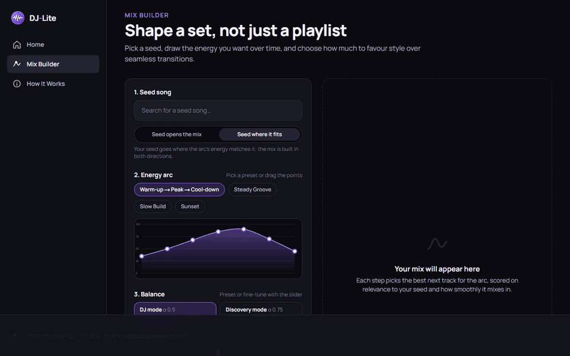
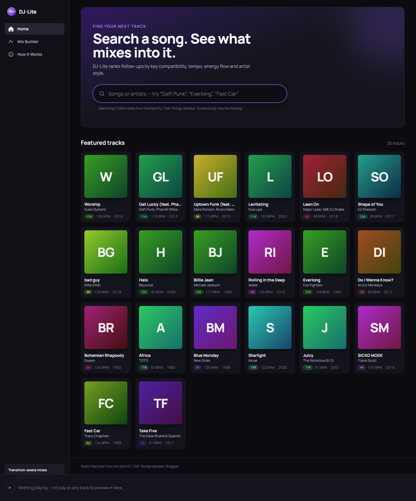
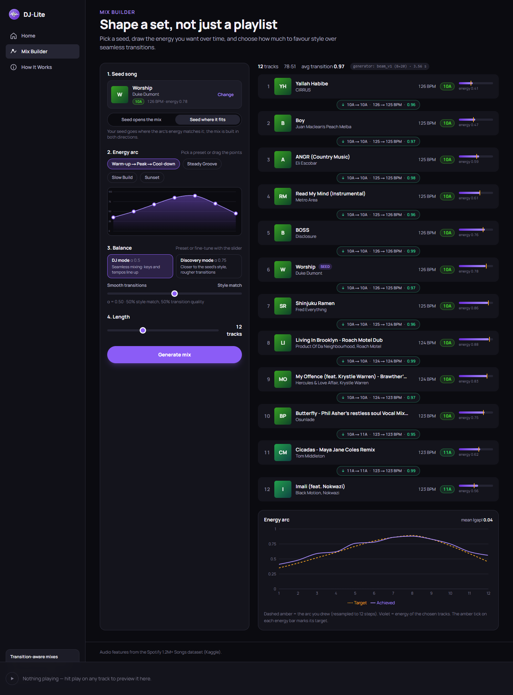
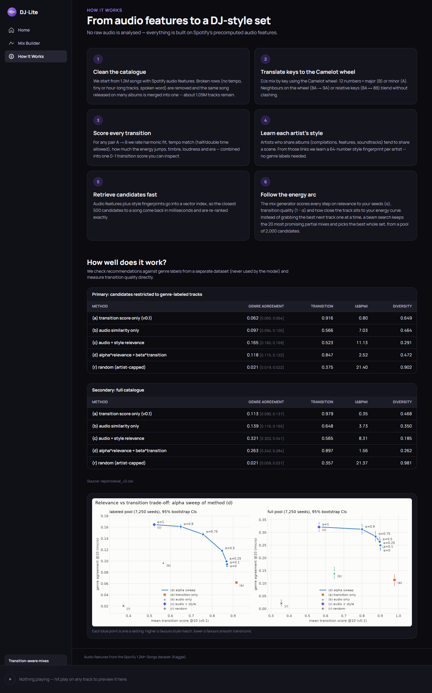

# DJ-Lite

**A transition-aware playlist recommender that builds DJ-style mixes: songs that blend in key and tempo and follow an energy arc you draw.**



## What it does

Pick a song you like and sketch how the energy should move over time: a slow build, a
warm-up to a peak and back down, a steady groove, or a sunset fade. DJ-Lite searches 1.09
million tracks for songs that sound like your seed and puts them in an order a DJ could
actually mix: neighbouring tracks are in compatible keys (on the Camelot wheel), within a
few BPM of each other, and their energy rises and falls with your curve. Every transition
comes with a score and a breakdown, so you can see why two songs fit. It works from
precomputed Spotify audio features only: no raw audio, no listening history, no genre tags.

| Home | Mix Builder | How It Works |
|---|---|---|
|  |  |  |

## Key results

Measured on **500 held-out seed songs never used for tuning**, x 4 energy-arc presets,
12-track mixes, 95% bootstrap intervals. Full tables, the tuning-set numbers, ablations
and limitations: **[reports/RESULTS.md](reports/RESULTS.md)**.

| Method (same candidate pool) | Mean transition score | Worst transition in the mix | Harmonically compatible | Largest BPM jump | Energy-arc error (MAE) |
|---|---:|---:|---:|---:|---:|
| **DJ-Lite (beam search, final)** | **0.951** [0.950, 0.953] | **0.909** [0.907, 0.911] | **99.8%** | **1.8 BPM** | **0.106** [0.099, 0.113] |
| Greedy, one track at a time | 0.946 | 0.902 | 99.7% | 1.8 BPM | 0.120 |
| Same tracks, sorted by energy | 0.864 | 0.684 | 75.0% | 3.7 BPM | 0.104 |
| Same tracks, random order | 0.815 | 0.612 | 65.4% | 4.3 BPM | 0.176 |

- **Ordering is what matters:** the same 12 tracks shuffled drop from a worst transition of
  0.91 to 0.61 and from 99.8% to 65% key-compatible transitions.
- **Beam search beats greedy** consistently but modestly (worst transition +0.008, arc
  error -0.014; identical margin on tuning and held-out seeds, at 12 and 24 tracks).
- **Held-out vs tuning:** transition metrics are identical; arc error is 0.106 vs 0.092 on
  the tuning set (the number to quote is the held-out one).
- **Search** returns the original artist first for 10 of 20 held-out famous-song queries.
- **Speed:** a 12-track mix takes ~1.2-1.7 s on a laptop CPU (single-threaded, ~2.3 GB
  RAM; the first request after startup ~2 s).

## Architecture

```mermaid
flowchart LR
    raw[("Spotify 1.2M+ Songs<br/>tracks_features.csv")] --> clean["Cleaning + dedup<br/>1.09M tracks"]
    clean --> feats["Features<br/>Camelot key, octave-aware tempo,<br/>standardized audio"]
    feats --> scorer["Transition scorer v0.1<br/>key, tempo, energy, timbre,<br/>loudness, era"]
    clean --> style["Style embeddings<br/>artist-album SVD (64-d)"]
    feats --> faiss["Retrieval<br/>FAISS inner-product index"]
    style --> faiss
    faiss --> gen["Beam-search arc generator<br/>relevance + transitions + arc fit"]
    scorer --> gen
    gen --> api["FastAPI backend<br/>/api/mix, /api/next, /api/search"]
    clean --> search[("SQLite FTS5<br/>search index")]
    search --> api
    api --> web["Next.js frontend<br/>Home, Mix Builder, How It Works"]
```

## How it works

**Cleaning.** The raw dataset has 1.2M rows with many re-releases of the same song
(albums, compilations, remasters). Rows with no tempo or extreme durations are dropped and
duplicates are merged in two passes (normalized title + artists, then title without
"feat." credits + primary artist), leaving 1,089,816 tracks
(`src/djlite/clean.py`, report in `reports/cleaning_report.txt`).

**Features and the Camelot wheel.** Each track's key and mode become a Camelot code (e.g.
8A, 9B), the notation DJs use for harmonic mixing: same number, +-1, or the relative
major/minor blend without clashing. Tempo is kept raw and aligned across octaves so a
128 BPM track can follow a 64 BPM one at half-time; the audio features are standardized
(`src/djlite/features.py`).

**Transition scorer.** For any pair A -> B, a rule-based score in [0, 1] combines harmonic
fit (30%), tempo match after octave alignment (30%), energy smoothness (15%), timbre
similarity (15%), loudness (5%) and era (5%), and returns the breakdown the app shows on
each transition chip (`src/djlite/transitions.py`, `configs/transitions.yaml`).

**Style embeddings.** There are no genre tags, but artists who share albums (compilations,
features, soundtracks) tend to share a scene. A TF-IDF artist x album matrix is factorized
with truncated SVD into a 64-dimensional style vector per artist, smoothed over two hops of
the artist-album graph (`src/djlite/style.py`).

**Retrieval.** Standardized audio features and style vectors go into a FAISS inner-product
index. Relevance to a seed is 0.35 audio + 0.50 style + 0.15 era similarity; next-track
lists re-rank the top 500 candidates exactly, mixing relevance and transition score
(`src/djlite/retrieval.py`).

**Beam-search arc generator.** For a mix, the 2,000 most relevant candidates (spread over 5
energy bands so the extremes of an arc have options) and their full pairwise transition
matrix are computed once. A beam search (width 20) then builds the whole playlist,
maximizing relevance to the seeds, transition quality with a penalty on weak links, and
fit to the target energy curve, under hard constraints: no repeats, one track per artist,
at most 3 BPM between neighbours. The seed is placed where the arc's energy matches it and
the mix grows in both directions (`src/djlite/generator.py`, `configs/generator.yaml`).

**FastAPI backend.** Loads the catalogue, FAISS index and search index once (~25 s) and
serves search, track details, next-track lists, mixes, cover URLs (Spotify oEmbed, cached,
rate-limited) and the evaluation summary (`app/backend/`).

**Next.js frontend.** Search with featured tracks, next-track recommendations with score
breakdowns, the Mix Builder (seed, drawable arc, DJ / Discovery balance, seed placement)
and a How It Works page with the evaluation tables (`app/frontend/`).

## Setup

### Prerequisites

- Python 3.11 and [uv](https://docs.astral.sh/uv/) (or plain `pip`)
- Node.js 20+ and npm
- ~8 GB RAM (the backend uses ~2.3 GB), ~4 GB free disk
- A Kaggle account to download the datasets

### Data

Download these from Kaggle and place the CSV files in `data/raw/` (the folder is
gitignored; nothing in `data/` is ever modified by the pipeline or committed):

| File | Dataset | Used for |
|---|---|---|
| `data/raw/tracks_features.csv` | [Spotify 1.2M+ Songs](https://www.kaggle.com/datasets/rodolfofigueroa/spotify-12m-songs) (Rodolfo Figueroa) | everything |
| `data/raw/dataset.csv` | [Spotify Tracks Dataset](https://www.kaggle.com/datasets/maharshipandya/-spotify-tracks-dataset) (Maharshi Pandya) | evaluation only (genre labels); optional for running the app |

### Build and run

PowerShell (Windows) shown; on macOS/Linux activate with `source .venv/bin/activate`. If
PowerShell refuses to run `Activate.ps1`, allow local scripts once with
`Set-ExecutionPolicy -Scope CurrentUser RemoteSigned`.

```powershell
# 1. Python environment
uv venv --python 3.11 .venv
.venv\Scripts\Activate.ps1
uv pip install -r requirements.txt -r app/backend/requirements.txt -e .

# 2. Data pipeline (about 10 minutes in total)
python -m djlite.clean                      # -> data/processed/  (cleaning + dedup)
python -m djlite.features                   # -> data/features/track_features.parquet
python -m djlite.style                      # -> data/features/track_style.parquet
python -m app.backend.build_search_index    # -> app/backend/cache/search.sqlite

# 3. Tests (synthetic fixtures; the search regression uses the index if present)
python -m pytest -q tests app/backend/tests

# 4. Backend (FAISS index is built in memory at startup, ~25 s)
uvicorn app.backend.main:app --port 8000

# 5. Frontend, in a second terminal
cd app/frontend
npm ci
npm run build
npm start                                   # http://localhost:3000
```

Frontend options (`app/frontend/.env.local`, read at build time, so rebuild after changing):

| Variable | Effect |
|---|---|
| `NEXT_PUBLIC_API_BASE=http://localhost:8000` | backend URL (default shown) |
| `NEXT_PUBLIC_API_MODE=mock` | offline demo on 30 built-in tracks, no backend needed |
| `NEXT_PUBLIC_COVERS=off` | no Spotify artwork or playback embed; generated tiles only (used for the images in this README) |

To reproduce the evaluation reports (needs `data/raw/dataset.csv`), see
[reports/RESULTS.md, section 9](reports/RESULTS.md#9-reproduce).

## Tech stack

- **Data and models:** Python 3.11, pandas, NumPy, PyArrow, scikit-learn (truncated SVD), FAISS (CPU)
- **Backend:** FastAPI, Uvicorn, Pydantic, httpx, SQLite FTS5
- **Frontend:** Next.js 15 (App Router), React 19, TypeScript, Tailwind CSS 4, Recharts, Framer Motion
- **Evaluation:** paired bootstrap CIs, held-out validation, matplotlib; pytest (243 tests)

## Known limitations

Summary; details in [reports/RESULTS.md, section 8](reports/RESULTS.md#8-known-limitations).

- No raw audio: energy is a single per-track value (no intros, outros or drops), and the
  transition scorer is rule-based, not validated against real DJ transitions.
- Genre labels (evaluation only) come from a separate dataset matched for 7,250 tracks, so
  genre-agreement numbers have wide intervals.
- The catalogue has gaps (many famous originals are missing or only present as covers),
  which limits search: 10/20 held-out famous songs return the original artist first.
- Defaults were tuned on 500 seeds and 20 search queries; a held-out run confirmed the
  transition results but revised the arc error (0.092 -> 0.106) and the search pass rate
  (12/20 -> 10/20). The ablations themselves were not replicated on held-out data.
- Single-seed mixes were evaluated; multi-seed mixes are supported but untested.

## Credits

- **Spotify 1.2M+ Songs** by Rodolfo Figueroa (Kaggle): audio features for all tracks.
- **Spotify Tracks Dataset** by Maharshi Pandya (Kaggle): genre labels, used only to evaluate.
- Album artwork and playback in the app come from Spotify's public oEmbed endpoint and embed
  player, fetched only for tracks on screen; they are not stored or redistributed. The
  images in this README were captured with `NEXT_PUBLIC_COVERS=off` and contain no artwork.
- DJ-Lite is an independent project and is not affiliated with or endorsed by Spotify.

## License

The code is released under the [MIT License](LICENSE). The datasets are not included or
redistributed in this repository; they remain under their own licenses and terms on Kaggle.
