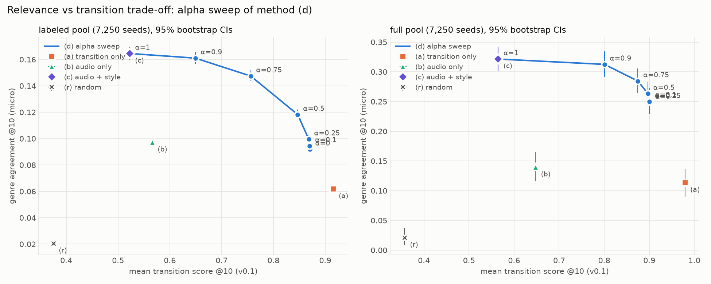

# Evaluation v2

K=500, alpha=0.5, beta=0.5, exclude_same_artist=True, max_per_artist=1, missing_style=renormalize; bootstrap 1000 resamples, 95% percentile CIs; every labeled seed evaluated once

## Labels

- genre dataset: 114,000 rows, 89,741 unique track IDs, 114 genres; 16,299 IDs (18.2%) carry >1 genre
- ID match: 4,142 genre IDs -> kept cleaned tracks (4.6%); 506 match only rows dropped as duplicates (not used)
- name match (normalized name + primary artist, dedup normalization): 7,174 cleaned tracks matched; 8,247 ambiguous keys skipped
-   NEW tracks labeled only via name: 3,108
-   precision proxy: for ID-matched genre rows with a name match, the name match hits the same track 100.0% of the time (n=4,067)
-   where both sources label a track, genre sets overlap 100.0% (n=4,066)
-   duration gap of new name matches (s): p50=0.1  p75=2.0  p90=19.7  p95=60.4  (>10 s: 12.9%)
- labeled cleaned tracks: 7,250 (id only 76, name only 3,108, both 4,066)

### Primary: labeled pool (candidates = genre-labeled tracks), 7,250 seeds

| method | genre agree (micro) | genre agree (macro) | transition@10 | |dBPM|@10 | ILD@10 | artist rep (uncapped) | labeled/list | seeds w/ label |
|---|---:|---:|---:|---:|---:|---:|---:|---:|
| (a) transition score only (v0.1) | 0.062 [0.060, 0.064] | 0.051 [0.049, 0.054] | 0.916 [0.915, 0.917] | 0.80 [0.79, 0.81] | 0.649 [0.647, 0.652] | 0.037 [0.036, 0.039] | 10.00 [10.00, 10.00] | 1.00 |
| (b) audio similarity only | 0.097 [0.094, 0.100] | 0.078 [0.075, 0.082] | 0.566 [0.565, 0.568] | 7.03 [6.95, 7.11] | 0.464 [0.462, 0.465] | 0.069 [0.067, 0.071] | 10.00 [10.00, 10.00] | 1.00 |
| (c) audio + style relevance | 0.165 [0.160, 0.169] | 0.136 [0.132, 0.143] | 0.523 [0.521, 0.524] | 11.13 [11.01, 11.25] | 0.291 [0.288, 0.294] | 0.214 [0.210, 0.218] | 10.00 [10.00, 10.00] | 1.00 |
| (d) alpha*relevance + beta*transition, alpha=0.5 | 0.118 [0.115, 0.122] | 0.100 [0.097, 0.105] | 0.847 [0.846, 0.848] | 2.52 [2.47, 2.57] | 0.472 [0.469, 0.475] | 0.083 [0.081, 0.086] | 10.00 [10.00, 10.00] | 1.00 |
| (r) random (artist-capped) | 0.021 [0.019, 0.022] | 0.018 [0.017, 0.020] | 0.375 [0.374, 0.377] | 21.40 [21.26, 21.56] | 0.902 [0.901, 0.904] | 0.006 [0.006, 0.007] | 10.00 [10.00, 10.00] | 1.00 |

### Alpha sweep, method (d), labeled pool (beta = 1 - alpha)

| method | genre agree (micro) | genre agree (macro) | transition@10 | |dBPM|@10 | ILD@10 | artist rep (uncapped) | labeled/list | seeds w/ label |
|---|---:|---:|---:|---:|---:|---:|---:|---:|
| (d) sweep, alpha=0 | 0.092 [0.089, 0.095] | 0.078 [0.075, 0.082] | 0.870 [0.869, 0.872] | 1.58 [1.55, 1.60] | 0.536 [0.533, 0.539] | 0.063 [0.061, 0.066] | 10.00 [10.00, 10.00] | 1.00 |
| (d) sweep, alpha=0.1 | 0.094 [0.092, 0.097] | 0.080 [0.078, 0.085] | 0.870 [0.869, 0.871] | 1.59 [1.57, 1.61] | 0.531 [0.528, 0.533] | 0.064 [0.062, 0.067] | 10.00 [10.00, 10.00] | 1.00 |
| (d) sweep, alpha=0.25 | 0.100 [0.097, 0.103] | 0.085 [0.082, 0.089] | 0.868 [0.867, 0.869] | 1.68 [1.66, 1.70] | 0.519 [0.517, 0.522] | 0.067 [0.065, 0.069] | 10.00 [10.00, 10.00] | 1.00 |
| (d) alpha*relevance + beta*transition, alpha=0.5 | 0.118 [0.115, 0.122] | 0.100 [0.097, 0.105] | 0.847 [0.846, 0.848] | 2.52 [2.47, 2.57] | 0.472 [0.469, 0.475] | 0.083 [0.081, 0.086] | 10.00 [10.00, 10.00] | 1.00 |
| (d) sweep, alpha=0.75 | 0.147 [0.143, 0.152] | 0.123 [0.120, 0.129] | 0.756 [0.754, 0.758] | 5.60 [5.50, 5.70] | 0.365 [0.362, 0.368] | 0.142 [0.139, 0.145] | 10.00 [10.00, 10.00] | 1.00 |
| (d) sweep, alpha=0.9 | 0.161 [0.157, 0.166] | 0.134 [0.130, 0.140] | 0.649 [0.647, 0.651] | 8.35 [8.24, 8.47] | 0.308 [0.305, 0.311] | 0.190 [0.186, 0.193] | 10.00 [10.00, 10.00] | 1.00 |
| (d) sweep, alpha=1 | 0.165 [0.160, 0.169] | 0.136 [0.132, 0.143] | 0.523 [0.521, 0.524] | 11.13 [11.01, 11.25] | 0.291 [0.288, 0.294] | 0.214 [0.210, 0.218] | 10.00 [10.00, 10.00] | 1.00 |

### Secondary: full pool (candidates = all cleaned tracks), 7,250 seeds

| method | genre agree (micro) | genre agree (macro) | transition@10 | |dBPM|@10 | ILD@10 | artist rep (uncapped) | labeled/list | seeds w/ label |
|---|---:|---:|---:|---:|---:|---:|---:|---:|
| (a) transition score only (v0.1) | 0.113 [0.090, 0.137] | 0.113 [0.084, 0.154] | 0.979 [0.979, 0.979] | 0.35 [0.34, 0.35] | 0.468 [0.465, 0.470] | 0.014 [0.014, 0.015] | 0.09 [0.08, 0.10] | 0.09 |
| (b) audio similarity only | 0.139 [0.116, 0.165] | 0.115 [0.090, 0.141] | 0.648 [0.646, 0.650] | 3.73 [3.68, 3.78] | 0.350 [0.348, 0.353] | 0.015 [0.014, 0.016] | 0.11 [0.10, 0.11] | 0.10 |
| (c) audio + style relevance | 0.321 [0.302, 0.341] | 0.260 [0.243, 0.289] | 0.565 [0.563, 0.567] | 8.31 [8.20, 8.42] | 0.185 [0.182, 0.188] | 0.319 [0.313, 0.325] | 0.29 [0.28, 0.30] | 0.23 |
| (d) alpha*relevance + beta*transition, alpha=0.5 | 0.263 [0.242, 0.284] | 0.250 [0.222, 0.279] | 0.897 [0.896, 0.898] | 1.56 [1.52, 1.59] | 0.262 [0.259, 0.265] | 0.127 [0.123, 0.130] | 0.25 [0.24, 0.26] | 0.21 |
| (r) random (artist-capped) | 0.021 [0.009, 0.037] | 0.027 [0.010, 0.049] | 0.357 [0.356, 0.359] | 21.37 [21.21, 21.51] | 0.981 [0.980, 0.982] | 0.001 [0.001, 0.001] | 0.06 [0.06, 0.07] | 0.06 |

### Alpha sweep, method (d), full pool (beta = 1 - alpha)

| method | genre agree (micro) | genre agree (macro) | transition@10 | |dBPM|@10 | ILD@10 | artist rep (uncapped) | labeled/list | seeds w/ label |
|---|---:|---:|---:|---:|---:|---:|---:|---:|
| (d) sweep, alpha=0 | 0.248 [0.229, 0.270] | 0.243 [0.214, 0.270] | 0.901 [0.900, 0.902] | 1.41 [1.38, 1.44] | 0.271 [0.268, 0.274] | 0.116 [0.113, 0.119] | 0.24 [0.23, 0.26] | 0.20 |
| (d) sweep, alpha=0.1 | 0.251 [0.231, 0.273] | 0.242 [0.214, 0.269] | 0.901 [0.900, 0.902] | 1.42 [1.38, 1.45] | 0.270 [0.267, 0.273] | 0.117 [0.114, 0.120] | 0.24 [0.23, 0.26] | 0.21 |
| (d) sweep, alpha=0.25 | 0.250 [0.229, 0.270] | 0.235 [0.208, 0.262] | 0.901 [0.899, 0.902] | 1.44 [1.41, 1.47] | 0.268 [0.265, 0.271] | 0.119 [0.116, 0.122] | 0.24 [0.23, 0.26] | 0.21 |
| (d) alpha*relevance + beta*transition, alpha=0.5 | 0.263 [0.242, 0.284] | 0.250 [0.222, 0.279] | 0.897 [0.896, 0.898] | 1.56 [1.52, 1.59] | 0.262 [0.259, 0.265] | 0.127 [0.123, 0.130] | 0.25 [0.24, 0.26] | 0.21 |
| (d) sweep, alpha=0.75 | 0.285 [0.264, 0.305] | 0.267 [0.242, 0.300] | 0.875 [0.873, 0.876] | 2.21 [2.17, 2.27] | 0.245 [0.242, 0.247] | 0.162 [0.158, 0.166] | 0.26 [0.25, 0.27] | 0.21 |
| (d) sweep, alpha=0.9 | 0.313 [0.292, 0.334] | 0.261 [0.242, 0.291] | 0.801 [0.798, 0.803] | 4.07 [3.99, 4.15] | 0.211 [0.208, 0.214] | 0.236 [0.231, 0.241] | 0.27 [0.26, 0.28] | 0.22 |
| (d) sweep, alpha=1 | 0.321 [0.302, 0.341] | 0.260 [0.243, 0.289] | 0.565 [0.563, 0.567] | 8.31 [8.20, 8.42] | 0.185 [0.182, 0.188] | 0.319 [0.313, 0.325] | 0.29 [0.28, 0.30] | 0.23 |

genre agree (micro) = mean per-seed share of labeled results whose genre set overlaps the seed's; seeds with no labeled result are excluded (seeds w/ label). (macro) = mean over genres of that per-seed value, seeds counted in each of their genres. artist rep is on the uncapped top-10; all other columns on the capped list. alpha=1 ranks FAISS candidates by relevance only (= method c); alpha=0 ranks the same candidates by transition only (unlike method a, which scans the whole pool).



## 20 random name-only matches

```
  GENRE  Ijime, Dame, Zettai  [BABYMETAL]  ['j-idol']
  OURS   Ijime, Dame, Zettai  ['BABYMETAL']  (2015)  gap=1.0s
  GENRE  Be F.L.A.M.E.  [Boris Brejcha]  ['minimal-techno']
  OURS   Be F.L.A.M.E.  ['Boris Brejcha']  (2013)  gap=0.0s
  GENRE  Un Millón De Años Luz - Remasterizado 2007  [Soda Stereo]  ['punk-rock', 'ska']
  OURS   Un Millón De Años Luz - Remasterizado 2007  ['Soda Stereo']  (1990)  gap=0.3s
  GENRE  La valse d'Amélie  [Yann Tiersen]  ['ambient', 'french']
  OURS   La Valse d'Amélie  ['Yann Tiersen', 'Lavinia Meijer']  (2015)  gap=22.6s
  GENRE  crossing field  [LiSA]  ['anime', 'j-rock']
  OURS   crossing field  ['LiSA']  (2012)  gap=2.0s
  GENRE  Noodling  [Kathleen Madigan]  ['comedy']
  OURS   Noodling  ['Kathleen Madigan']  (2018)  gap=0.0s
  GENRE  Nada Nuevo bajo el Sol  [Víctor Manuel]  ['spanish']
  OURS   Nada Nuevo bajo el Sol  ['Víctor Manuel']  (2014)  gap=0.2s
  GENRE  Fooled Around And Fell In Love  [Elvin Bishop]  ['blues']
  OURS   Fooled Around And Fell In Love  ['Elvin Bishop']  (1995)  gap=8.6s
  GENRE  Lenny  [Stevie Ray Vaughan]  ['blues']
  OURS   Lenny  ['Stevie Ray Vaughan']  (1983)  gap=0.2s
  GENRE  Black Holes (Solid Ground)  [The Blue Stones]  ['blues', 'hard-rock']
  OURS   Black Holes (Solid Ground)  ['The Blue Stones']  (2018)  gap=0.0s
  GENRE  The Other Woman In My Life  [Ray Price]  ['honky-tonk']
  OURS   The Other Woman In My Life  ['Ray Price']  (2005)  gap=0.8s
  GENRE  Televised Green Smoke  [Carl Craig]  ['detroit-techno']
  OURS   Televised Green Smoke  ['Carl Craig']  (2001)  gap=4.5s
  GENRE  I Bet You Look Good On The Dancefloor  [Arctic Monkeys]  ['garage']
  OURS   I Bet You Look Good On The Dancefloor  ['Arctic Monkeys']  (2005)  gap=2.8s
  GENRE  Not a Day Goes By (From "Merrily We Roll Along") - Live  [Bernadette Peters]  ['show-tunes']
  OURS   Not a Day Goes By (From "Merrily We Roll Along") - Live  ['Bernadette Peters']  (1993)  gap=10.1s
  GENRE  Could It Be I'm Falling in Love  [The Spinners]  ['disco', 'funk', 'soul']
  OURS   Could It Be I'm Falling In Love  ['The Spinners']  (2018)  gap=0.3s
  GENRE  Would That I  [Hozier]  ['singer-songwriter', 'songwriter']
  OURS   Would That I  ['Hozier']  (2019)  gap=0.0s
  GENRE  Casi un Hechizo  [Jerry Rivera]  ['salsa']
  OURS   Casi un Hechizo  ['Jerry Rivera']  (1990)  gap=51.2s
  GENRE  Highway Star - Remastered 2012  [Deep Purple]  ['blues', 'hard-rock', 'metal', 'psych-rock']
  OURS   Highway Star  ['Deep Purple']  (1972)  gap=2.4s
  GENRE  I'll Be There (If You Ever Want Me) - 78rpm Version  [Ray Price]  ['honky-tonk']
  OURS   I'll Be There (If You Ever Want Me) - 78rpm Version  ['Ray Price']  (1991)  gap=1.3s
  GENRE  Comfortably Numb - Live  [Pink Floyd]  ['psych-rock']
  OURS   Comfortably Numb - Live  ['Pink Floyd']  (1988)  gap=34.1s
```

## Known limitations

- **FAISS missing-style retrieval bias.** Retrieval searches [sqrt(w_audio)·audio, sqrt(w_style)·style]. A candidate without a style vector (artist on no shared album; ~38% of tracks) has a zero style block, so for a seed *with* style its inner product is only w_audio·cos_audio and it ranks below styled candidates in the top-K. Exact re-ranking renormalizes the relevance for such candidates (0.70 audio / 0.30 era), but it can only re-rank what FAISS returned, so style-less tracks are under-represented for methods (c) and (d). For a seed without style, the query's style block is zero and retrieval is audio-only, which is unbiased.
- Method (a) scans the whole pool; (b) uses an audio-only index; (c) and (d) re-rank the top K=500 from the combined index.
- Genre labels come from a different Kaggle dataset matched by track ID (v1) or by track ID plus normalized name + primary artist (v2); a track can carry several genres there, and any overlap counts as agreement. Name-only matches cannot be verified automatically: the precision proxy (ID-matched rows) checks that the normalization routes keys correctly, not that same-title same-artist tracks are the same recording; inspect the listed examples.
- Genres are imbalanced and some have very few labeled tracks, so macro agreement is driven partly by small genres and has wide CIs.
