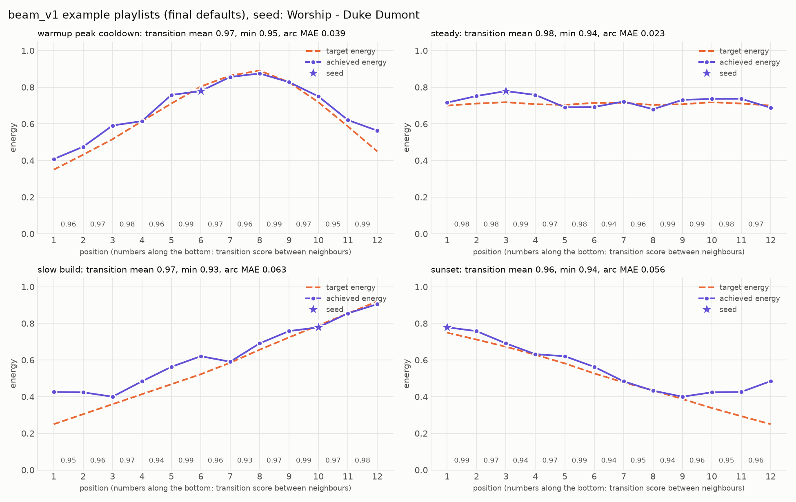

# Example playlists (final generator defaults)

alpha 0.5, gamma 0.25, lambda 2.0 (tau 0.85), |dBPM| cap 3, energy bands 5, seed position best_fit, B 20

**warmup peak cooldown** (1612 ms, seed at position 6)

| # | track | artist | Camelot | BPM | energy | target | transition in |
|---:|---|---|---|---:|---:|---:|---:|
| 1 | Yallah Habibe | CIRRUS | 10A | 126 | 0.41 | 0.35 |  |
| 2 | Boy | Juan Maclean's Peach Melba | 10A | 125 | 0.47 | 0.43 | 0.96 |
| 3 | ANGR (Country Music) | Eli Escobar | 10A | 125 | 0.59 | 0.52 | 0.97 |
| 4 | Read My Mind (Instrumental) | Metro Area | 10A | 125 | 0.61 | 0.61 | 0.98 |
| 5 | BOSS | Disclosure | 10A | 126 | 0.76 | 0.71 | 0.96 |
| 6 | **Worship** (seed) | Duke Dumont | 10A | 126 | 0.78 | 0.80 | 0.99 |
| 7 | Shinjuku Ramen | Fred Everything | 10A | 125 | 0.86 | 0.86 | 0.97 |
| 8 | Living In Brooklyn - Roach Motel Dub | Product Of Da Neighbourhood | 10A | 124 | 0.88 | 0.89 | 0.96 |
| 9 | My Offence (feat. Krystle Warren) - Brawther's Mean Dub | Hercules & Love Affair | 10A | 124 | 0.83 | 0.83 | 0.99 |
| 10 | Butterfly - Phil Asher's restless soul Vocal Mix, Mixed | Osunlade | 10A | 123 | 0.75 | 0.72 | 0.97 |
| 11 | Cicadas - Maya Jane Coles Remix | Tom Middleton | 11A | 123 | 0.62 | 0.59 | 0.95 |
| 12 | Imali (feat. Nokwazi) | Black Motion | 11A | 123 | 0.56 | 0.45 | 0.99 |

**steady** (1606 ms, seed at position 3)

| # | track | artist | Camelot | BPM | energy | target | transition in |
|---:|---|---|---|---:|---:|---:|---:|
| 1 | Beau Mot Plage - Heaven & Earth Re-Edit | Isolée | 10A | 128 | 0.72 | 0.70 |  |
| 2 | Afrik Bounce - Original | Groove Assassin | 10A | 127 | 0.75 | 0.71 | 0.98 |
| 3 | **Worship** (seed) | Duke Dumont | 10A | 126 | 0.78 | 0.72 | 0.98 |
| 4 | BOSS | Disclosure | 10A | 126 | 0.76 | 0.71 | 0.99 |
| 5 | Larry's Exotic Blend | Zappe | 10A | 125 | 0.69 | 0.70 | 0.97 |
| 6 | Higher - Benji Candelario Thump Mix | Benji Candelario | 10A | 124 | 0.69 | 0.71 | 0.98 |
| 7 | Right Thing (feat. Ben Westbeech) | Dennis Ferrer | 9A | 123 | 0.72 | 0.71 | 0.94 |
| 8 | Searching (feat. Melisa Whiskey) - Mixed | S-Man | 9B | 123 | 0.68 | 0.70 | 0.96 |
| 9 | Momma's Groove - Jimpster's Hip Replacement Mix, Mixed | Osunlade | 9B | 123 | 0.73 | 0.71 | 0.99 |
| 10 | Ride Your Body (feat. Max C) [Sabb Afterdark Mix] - Mixed | Emanuel Satie | 9B | 123 | 0.74 | 0.72 | 0.99 |
| 11 | Wide Awake! - Club Mix | Parquet Courts | 9B | 124 | 0.74 | 0.71 | 0.98 |
| 12 | Magic | Cevin Fisher | 9B | 125 | 0.69 | 0.70 | 0.97 |

**slow build** (1609 ms, seed at position 10)

| # | track | artist | Camelot | BPM | energy | target | transition in |
|---:|---|---|---|---:|---:|---:|---:|
| 1 | The Velvet Slide | Shiny Objects | 11B | 122 | 0.43 | 0.25 |  |
| 2 | Rendez-Vous (feat. Ingrid Hakanson) - Loui & Scibi Remix | Lumoon & Rob!n | 12B | 121 | 0.42 | 0.30 | 0.95 |
| 3 | Can't Believe - Maxxi Soundsystem Rework | The Mekanism | 12A | 121 | 0.40 | 0.36 | 0.96 |
| 4 | Never Lies - Extended Mix | Sonny Fodera | 12A | 122 | 0.48 | 0.41 | 0.97 |
| 5 | Imali (feat. Nokwazi) | Black Motion | 11A | 123 | 0.56 | 0.47 | 0.94 |
| 6 | Cicadas - Maya Jane Coles Remix | Tom Middleton | 11A | 123 | 0.62 | 0.52 | 0.99 |
| 7 | Stomp The Ground - Mixed | Jovonn | 10A | 123 | 0.59 | 0.59 | 0.96 |
| 8 | Larry's Exotic Blend | Zappe | 10A | 125 | 0.69 | 0.66 | 0.93 |
| 9 | BOSS | Disclosure | 10A | 126 | 0.76 | 0.72 | 0.97 |
| 10 | **Worship** (seed) | Duke Dumont | 10A | 126 | 0.78 | 0.79 | 0.99 |
| 11 | Enjoy Music - Riva Starr Remix | Reboot | 10A | 127 | 0.85 | 0.85 | 0.97 |
| 12 | In The Trees - Jerome Sydenham & Tiger Stripes Rendition | Faze Action | 10A | 127 | 0.91 | 0.92 | 0.98 |

**sunset** (1606 ms, seed at position 1)

| # | track | artist | Camelot | BPM | energy | target | transition in |
|---:|---|---|---|---:|---:|---:|---:|
| 1 | **Worship** (seed) | Duke Dumont | 10A | 126 | 0.78 | 0.75 |  |
| 2 | BOSS | Disclosure | 10A | 126 | 0.76 | 0.71 | 0.99 |
| 3 | Larry's Exotic Blend | Zappe | 10A | 125 | 0.69 | 0.67 | 0.97 |
| 4 | Butterfly - Phil Asher's restless soul Vocal Mix | Osunlade | 10A | 123 | 0.63 | 0.63 | 0.94 |
| 5 | Cicadas - Maya Jane Coles Remix | Tom Middleton | 11A | 123 | 0.62 | 0.58 | 0.97 |
| 6 | Imali (feat. Nokwazi) | Black Motion | 11A | 123 | 0.56 | 0.53 | 0.99 |
| 7 | Never Lies - Extended Mix | Sonny Fodera | 12A | 122 | 0.48 | 0.48 | 0.94 |
| 8 | The Honeymoon - M.ono Remix | Kumquat | 1A | 122 | 0.43 | 0.43 | 0.95 |
| 9 | Can't Believe - Maxxi Soundsystem Rework | The Mekanism | 12A | 121 | 0.40 | 0.39 | 0.94 |
| 10 | Rendez-Vous (feat. Ingrid Hakanson) - Loui & Scibi Remix | Lumoon & Rob!n | 12B | 121 | 0.42 | 0.34 | 0.96 |
| 11 | The Velvet Slide | Shiny Objects | 11B | 122 | 0.43 | 0.29 | 0.95 |
| 12 | Miss My Luv - Dub | Eli Escobar | 10B | 122 | 0.48 | 0.25 | 0.96 |
